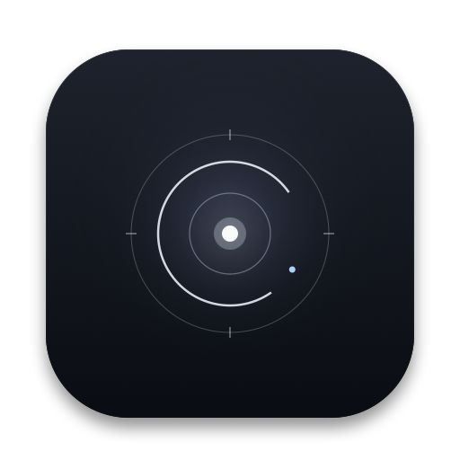

<p align="center">
  
</p>

<h1 align="center">Recall</h1>

<p align="center">
  <em>A quieter clipboard. A memory you can ask for.</em>
</p>

<p align="center">
  
  
  
  
  
</p>

---

Recall is a menu-bar-only clipboard memory for macOS. Press **`⌥Space`**,
describe what you remember, and it finds the thing — even when the words are
different, even when the note is in another language.

No Dock icon. No account. No telemetry. No cloud sync. The interface is one
quiet panel that appears when asked and disappears when done.

> Recall is pre-1.0. Build from source for now; signed releases will be
> published when notarization is ready.

## The idea

Clipboards are write-only by design. You copy a sentence, a URL, a snippet of
code, and a few minutes later it has been replaced by something else. Recall
keeps a small, private history and makes it searchable by meaning.

The important part is what it does *not* do:

- It does not show a dashboard.
- It does not ask you to organize anything.
- It does not return fifty almost-matches.
- It does not leave your Mac to understand a sentence.

## What it does

- **`⌥Space` from anywhere.** A Spotlight-shaped panel appears over the current
  app, ready for a query.
- **Search by meaning.** “that SQL query about users from last week” finds both
  the English `SELECT` and the Russian note written about it. No keywords
  required.
- **English and Russian, together.** EmbeddingGemma 2 maps both languages into
  one 768-dimensional space. The model supports 100+ languages; English and
  Russian are the pair Recall is tested against.
- **On-Device Query Assistant.** Powered by lightweight Qwen 2.5 0.5B Core ML
  and Apple NLP to interpret conversational and descriptive queries with zero
  network calls.
- **Local Vision OCR.** Screenshots and copied images have their text extracted
  on-device using Apple Vision and indexed automatically into SQLite FTS5 and
  vectors.
- **Five close matches, not a landfill.** The semantic result set is
  authoritative. Keyword matches can reorder those items, but never pad the
  list with unrelated copies that merely share a word.
- **Paste without leaving the keyboard.** `↵` copies and closes. `⌘↵` copies
  and pastes into the app you came from, if Accessibility is enabled.
- **A real menu-bar citizen.** No Dock tile, no app switcher entry, no window
  when you are not looking for something.
- **Native where it counts.** AppKit `NSPanel`, SwiftUI content, SQLite FTS5,
  Core ML on the Neural Engine, and Liquid Glass on macOS 26+.
- **Local-first.** The database and images live in
  `~/Library/Application Support/Recall`. The only optional download is the
  embedding model.

## The model

Semantic search is powered by **EmbeddingGemma 2**, converted to Core ML for the
Apple Neural Engine.

| | |
| --- | --- |
| Model | EmbeddingGemma 2 (text encoder) |
| Dimensions | 768, L2-normalized |
| Languages | 100+ multilingual |
| Download | ~585 MB, one time |
| Assets | 6 pinned files, each verified with SHA-256 |
| Runtime | Core ML, `.cpuAndNeuralEngine` |
| Fallback | Apple `NLContextualEmbedding` (512-d, per-script) |
| License | Apache 2.0 |

The conversion is pinned to
[`FluidInference/embeddinggemma-2-coreml`](https://huggingface.co/FluidInference/embeddinggemma-2-coreml)
at revision `70fcf18f32c8cffc173fea982d5652d0bd1de8ea`. Recall downloads it
from Hugging Face only when you choose **Download model**, verifies every byte,
compiles the package once, and keeps it on disk for offline use.

If you skip the download, Recall still works with Apple's built-in contextual
embedding model. It is smaller and per-language, but it needs no download and
keeps the product useful before the model is ready.

See [`docs/MODEL.md`](docs/MODEL.md) for prompts, calibration, and the provider
switch.

## Privacy

Recall is designed around a short list of promises:

- **No accounts, analytics, telemetry, or sync.**
- **No clipboard content is uploaded.** Embeddings are computed on-device.
- **Concealed and transient clipboard types are skipped.** Passwords and
  transient drags are not remembered.
- **Secure input is respected.** When macOS reports secure keyboard entry,
  capture stops.
- **Excluded apps stay excluded.** Add any app in Settings; copies made there
  are never stored.
- **Auto-paste is optional.** It uses Accessibility only to post `⌘V`; the rest
  of the app works without it.
- **You can erase everything.** Delete all history, remove the model, or show
  the database in Finder from Settings.

The only app-initiated network request is the optional model download from
Hugging Face. macOS may separately manage its own language assets for the
fallback model.

## Install

### Quick Install (1-Line Terminal)

The fastest way to install without Gatekeeper hurdles:

```sh
curl -fsSL https://raw.githubusercontent.com/miras/recall/main/install.sh | bash
```

This downloads the latest release, installs it to `/Applications`, strips the quarantine flag, and launches the app.

### Direct Download (DMG)

Download `Recall-v0.1.0-macos-arm64.dmg` from the [Latest Releases](https://github.com/miras/recall/releases).

#### Opening on macOS Sequoia (15+) without Apple Developer ID:
Because Recall is an independent open-source project without a paid Apple Developer certificate:
1. Drag **Recall.app** to `/Applications` and double-click it.
2. Click **Done** when macOS shows the unverified developer prompt.
3. Open **System Settings → Privacy & Security**, scroll down to the **Security** section, and click **"Open Anyway"**.
4. Enter your Mac password and click **Open**.

*Alternatively, run this single command in Terminal to bypass Gatekeeper:*
```sh
xattr -cr /Applications/Recall.app
```

### Requirements

- macOS 15 or later
- Apple Silicon (M1 / M2 / M3 / M4)
- Xcode 26 or later (only if building from source)

### Build from source

```sh
git clone https://github.com/miras/recall.git
cd recall
make build
make run
```

### First run

Onboarding has four clean steps:
1. **Welcome** — Privacy-first overview.
2. **Clipboard Permission** — Access to remember copied snippets.
3. **Neural Memory** — Download and compile EmbeddingGemma 2 (768-d Core ML) or use Apple's built-in contextual fallback.
4. **Query Assistant** — Lightweight Qwen 2.5 0.5B Core ML assistant for natural language rephrasing (optional).

You can reset your clipboard history and replay onboarding at any time from **Settings → Privacy → Reset and replay onboarding…** without re-downloading your installed models.

## Controls

| Shortcut | Action |
| --- | --- |
| `⌥Space` | Open or close Recall |
| Type | Search by meaning |
| `↑` `↓` | Move selection |
| `↵` | Copy and close |
| `⌥↵` | Copy and keep the panel open |
| `⌘↵` | Copy and paste into the previous app |
| `Tab` / `⇧Tab` | Cycle all, text, code, links, images |
| `Esc` | Clear the query; press again to close |
| `⌘⌫` | Delete the selected item |
| `⌘D` | Favorite or unfavorite |
| `⌘,` | Open Settings |

## How it works

1. **Capture.** A lightweight monitor watches the pasteboard change counter,
   ignores concealed/transient types, excluded apps, secure input, and Recall's
   own writes, then classifies the copy as text, code, a link, or an image.
2. **Store.** Items go into SQLite with a content hash, source app, timestamp,
   and an FTS5 row. Embeddings are stored as a BLOB with their provider and
   language, so the model can change without poisoning old vectors.
3. **Recall.** A query is parsed for filters and dates, embedded with the
   search prompt, and compared against an in-memory, per-language matrix with
   Accelerate. The semantic set is filtered with an absolute floor and a
   top-relative margin, then fused with keyword ranks.
4. **Paste.** `↵` writes the item back to the pasteboard and closes the panel.
   `⌘↵` additionally asks Accessibility to post `⌘V` to the frontmost app.

Read [`docs/ARCHITECTURE.md`](docs/ARCHITECTURE.md) for the module map and
invariants.

## Project layout

```text
Recall/
├── App/                    AppDelegate, AppState, hot key, menu bar, panel
├── Core/
│   ├── Capture/            Pasteboard monitor and classification boundary
│   ├── Model/              ClipItem, ItemKind, content classification
│   ├── Permissions/        Pasteboard, Accessibility, paste writer
│   ├── Search/             Query parser, FTS, semantics, vectors, model store
│   ├── Settings/           Observable preferences
│   └── Storage/            SQLite wrapper, schema, FTS5, embeddings
├── Design/                 Theme, glass, hosting helpers
├── Features/
│   ├── Onboarding/         Three-step first run
│   ├── Panel/              Spotlight-style panel
│   └── Settings/           Model, privacy, and history controls
└── Assets.xcassets/        Icon and accent color
```

## Testing

Recall uses Swift Testing. The suite covers storage, FTS parsing, content
classification, and rank fusion.

```sh
xcodebuild \
  -project Recall.xcodeproj \
  -scheme Recall \
  -destination 'platform=macOS' \
  CODE_SIGNING_ALLOWED=NO \
  test
```

CI runs the same build and test commands on macOS. See
[`.github/workflows/ci.yml`](.github/workflows/ci.yml).

## Documentation

- [`docs/ARCHITECTURE.md`](docs/ARCHITECTURE.md) — modules, data flow, and invariants
- [`docs/MODEL.md`](docs/MODEL.md) — model prompts, providers, and calibration
- [`THIRD_PARTY_NOTICES.md`](THIRD_PARTY_NOTICES.md) — attribution and licenses
- [`CONTRIBUTING.md`](CONTRIBUTING.md) — local development and review notes

## License

Recall's application code is released under the **MIT License**. See
[`LICENSE`](LICENSE).

The EmbeddingGemma 2 Core ML conversion and the adapted FluidUse runtime are
distributed under the **Apache License 2.0**. See
[`THIRD_PARTY_NOTICES.md`](THIRD_PARTY_NOTICES.md) and
[`LICENSES/Apache-2.0.txt`](LICENSES/Apache-2.0.txt).

## Credits

- **FluidInference** for the EmbeddingGemma 2 Core ML conversion and the
  FluidUse runtime.
- **Google DeepMind** for EmbeddingGemma 2.
- **Apple** for the frameworks that make a small, fast, local app possible.
- Everyone who copies something important and expects to find it again.

---

<p align="center">
  <sub>Recall is an independent open-source project. It is not affiliated with
  Apple or Google.</sub>
</p>

---

<!-- mk-studio:start -->
<p align="center"><a href="https://www.mk-studio.xyz"></a></p>
<!-- mk-studio:end -->
